# SuwaLink — System Diagrams

Reflects the system as of the bug-fix + merge pass on `fix/bug-hunt-phase1`: auth (incl.
password reset), inventory, prescription requests, prescription responses, reservations,
notifications, and admin.

## Entity-Relationship Diagram

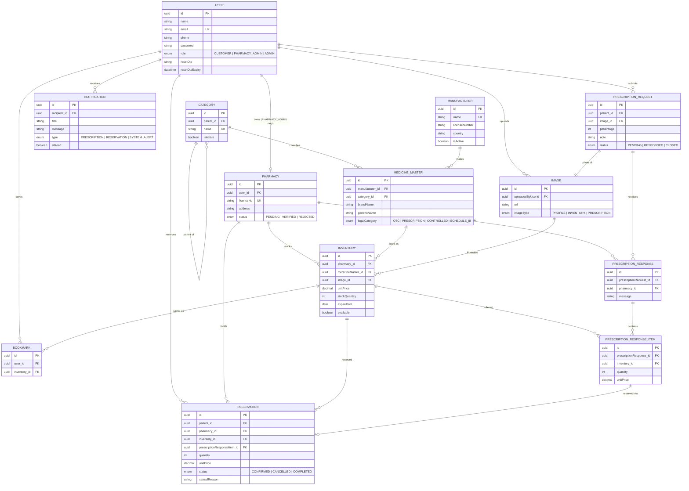

---

## Use Case Diagram

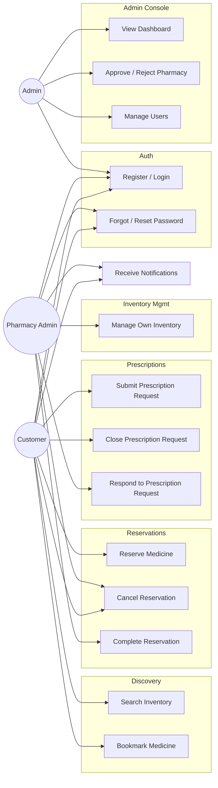

---

## Class Diagram (service layer, by module)

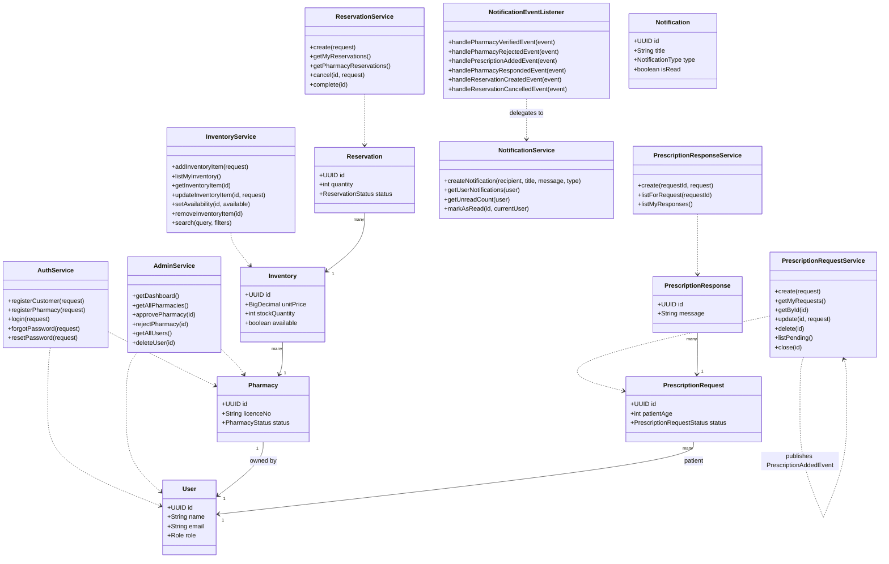

---

## Sequence Diagrams

### Login

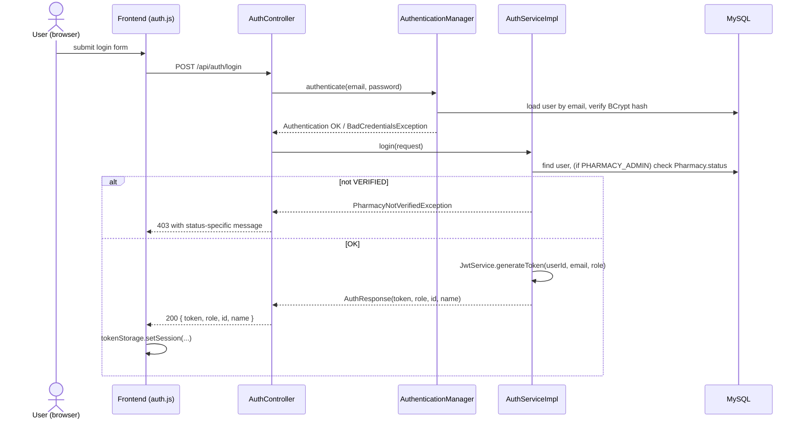

### Forgot / Reset Password

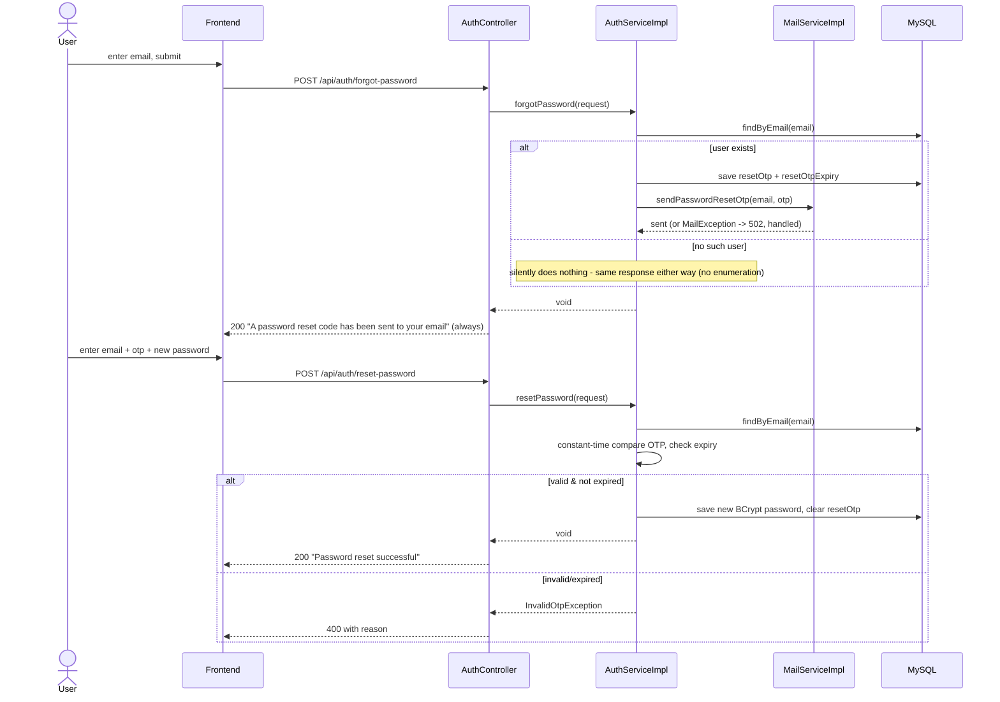

### Prescription Request Created → Pharmacies Notified

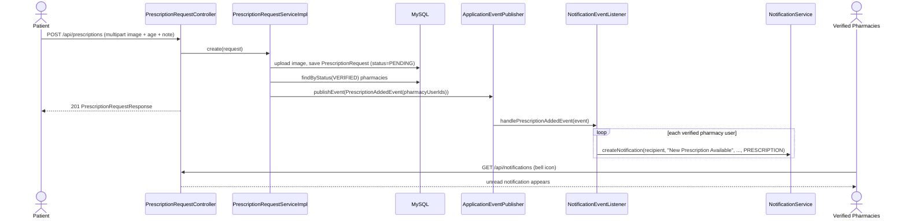

### Admin Approves/Rejects a Pharmacy → Applicant Notified

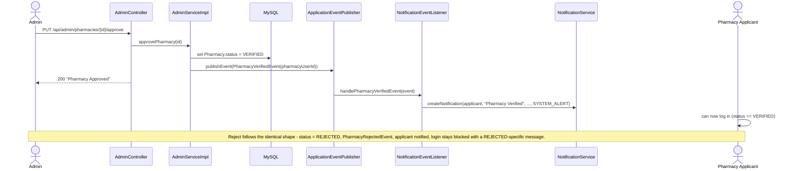

### Notification Read

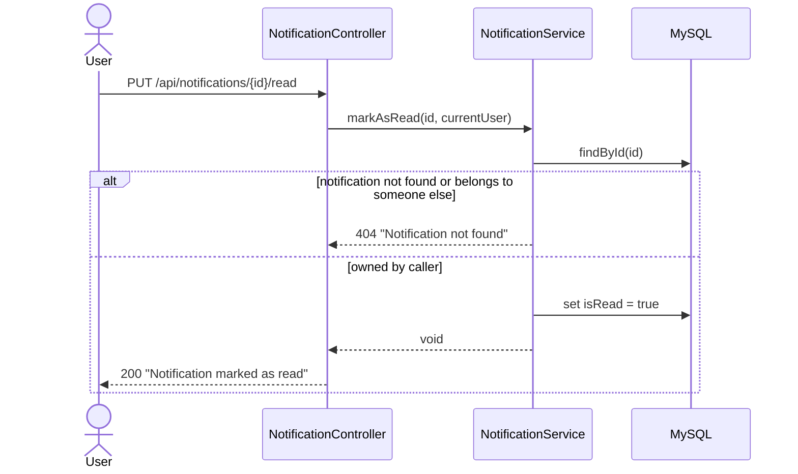

---

## Activity Diagrams

### Customer prescription → reservation journey

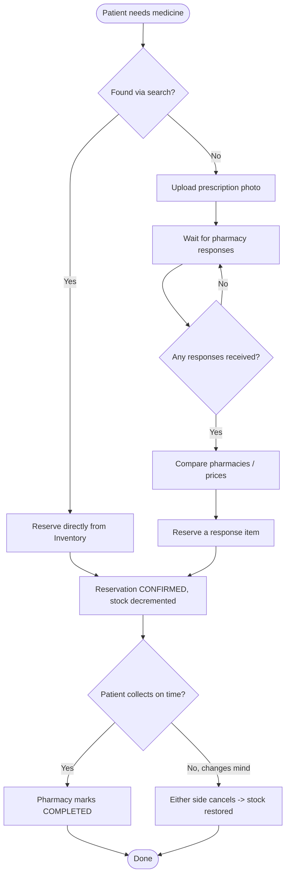

### Pharmacy inventory + response journey

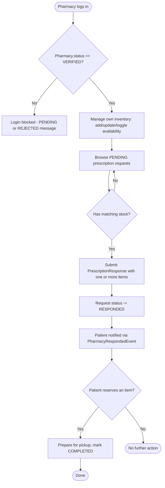

### Admin pharmacy verification journey

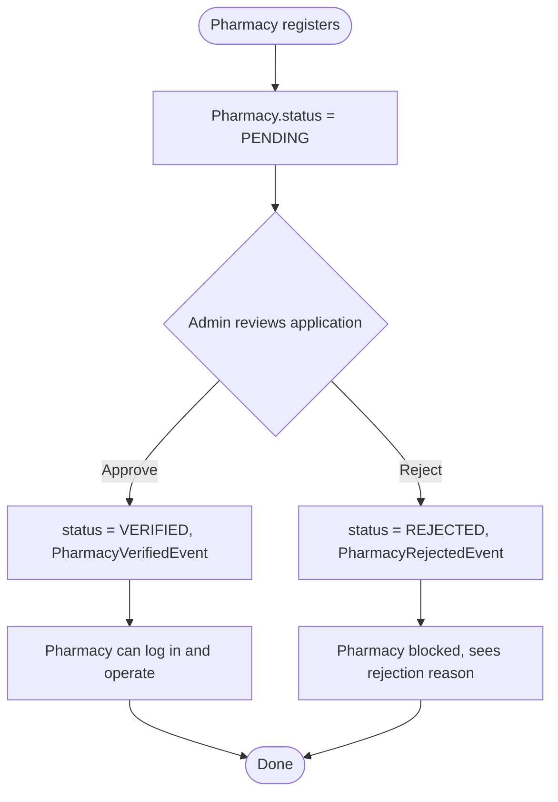

---

## State Diagrams

### PrescriptionRequestStatus

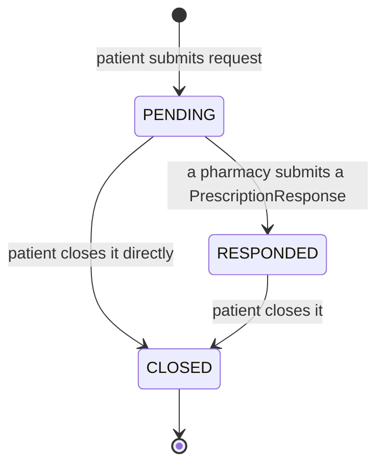

### PharmacyStatus

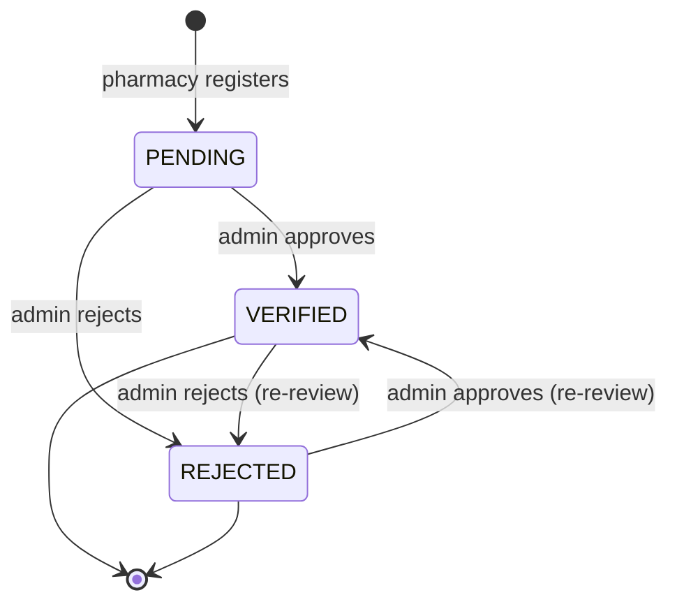

### ReservationStatus

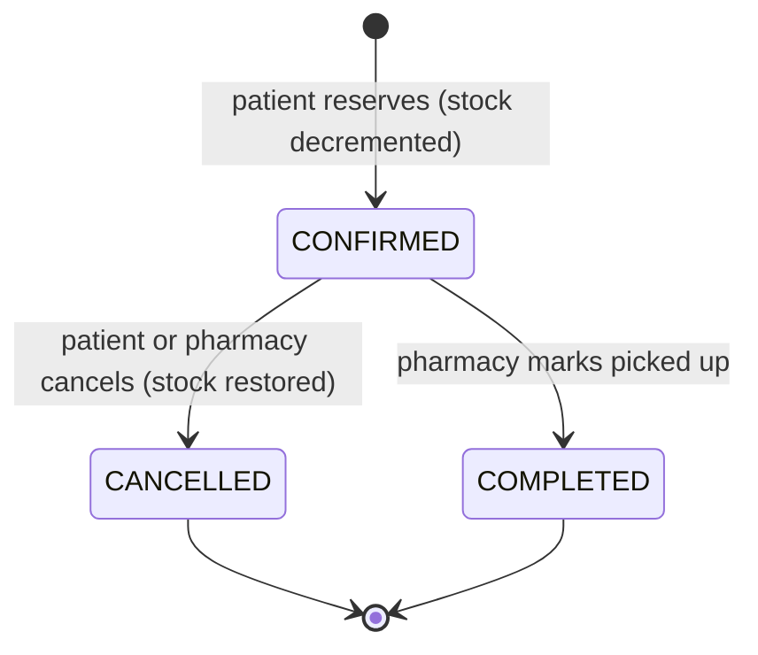
