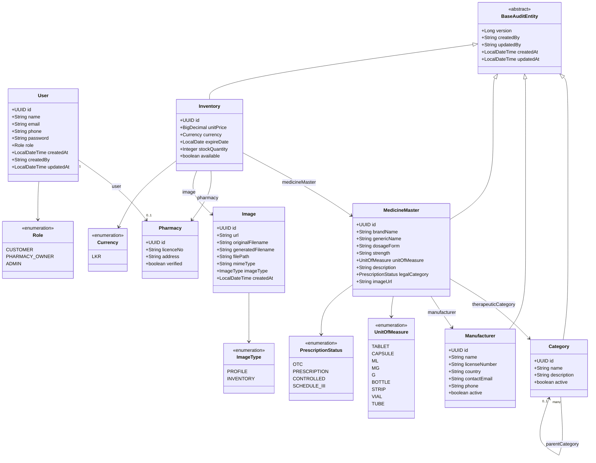

# Inventory Module — What's Built, How to Use It

Covers the inventory/catalog side of SuwaLink: medicine catalog (`MedicineMaster`, `Category`, `Manufacturer`), pharmacy stock (`Inventory`), image uploads, and patient-facing search. Builds on top of the auth module (see `READ_AUTHENTICATION_ENDPOINT.md`).

## Class diagram



`Category`, `Manufacturer`, `MedicineMaster`, and `Inventory` are also `@Audited` (Hibernate Envers) — each has a shadow `_aud` table plus a shared `revinfo` table tracking full change history, separate from the `createdBy`/`updatedAt` fields above (which answer "who touched it last," not "what did it look like before").

## Layers (per entity/feature)

Same pattern as the auth module — Controller → Service (interface + impl) → Repository, DTOs only at the boundary, never entities:

| Feature | Controller | Endpoints |
|---|---|---|
| Inventory (pharmacy-owned stock) | `InventoryController` | `/api/inventory` — CRUD, `/availability`, `/search` |
| Categories (admin reference data) | `CategoryController` | `/api/admin/categories` — CRUD |
| Manufacturers (admin reference data) | `ManufacturerController` | `/api/admin/manufacturers` — CRUD |
| Medicine catalog (admin reference data) | `MedicineMasterController` | `/api/admin/medicines` — CRUD |
| Image upload | `ImageController` | `POST /api/images` |

Role gating: `PHARMACY_OWNER` owns `/api/inventory` (except `/search`, open to any authenticated user); `ADMIN` owns the three `/api/admin/**` controllers. There is a bootstrap admin account seeded via migration — see `app.upload.dir`/migration notes below for how to log in as it.

## Ownership enforcement

Every mutating `Inventory` endpoint checks the row's `pharmacy` matches the *currently authenticated* pharmacy (via `CurrentUserProvider` → `PharmacyRepository.findByUserId`) before allowing the change — one pharmacy can never edit another pharmacy's stock, even by guessing a UUID.

## Image uploads

- `POST /api/images` (multipart, any authenticated user) — accepts an image file + `imageType` (`PROFILE` or `INVENTORY`), converts it to **WebP** on the server (via `webp4j`), stores it on local disk under `app.upload.dir` (default `uploads/`, gitignored), and saves only metadata in MySQL (`Image` entity: original filename, generated filename, file path, mime type) — never the binary itself, per `CONTEXT/SPECS.md`.
- Uploaded files are served back publicly at `/uploads/<generated-filename>.webp` (no auth — browsers can't attach a JWT to a plain `` tag, so this path is explicitly `permitAll()`'d in `SecurityConfig`).
- The returned `Image.id` gets passed as `imageId` when creating/updating an `Inventory` item.

## Swagger / OpenAPI

`springdoc-openapi` is already a dependency — it auto-scans every `@RestController` on the classpath and generates the API docs with **zero manual annotation required** (no `@Operation`/`@ApiOperation` needed for basic discovery; add them later only if you want nicer descriptions per endpoint).

With the backend running:
- **Interactive UI:** `http://localhost:8080/swagger-ui/index.html`
- **Raw OpenAPI JSON:** `http://localhost:8080/v3/api-docs`

Both paths are `permitAll()`'d in `SecurityConfig` — otherwise the JWT filter would 401 them like everything else.

## Running it locally

1. **Database**: `docker compose up -d` from the repo root (or `./scripts/dev-up.sh`, which also stops any other container hogging a port SuwaLink needs, e.g. 8080).
2. **Backend**: `cd backend && ./mvnw spring-boot:run` — needs JDK 25. Schema is managed by **Liquibase**, not Hibernate (`spring.jpa.hibernate.ddl-auto=validate`) — migrations in `backend/src/main/resources/db/changelog/` apply automatically on every boot, including seed reference data (categories, manufacturers, three sample medicines). A bootstrap admin (`admin@suwalink.local`, dev-only password in `application-dev.properties`) is created at startup by `AdminBootstrap`.
3. **Frontend**: `cd frontend && python -m http.server 5500` (must be this port — CORS allow-list).

### Adding a new migration

Liquibase applies migrations automatically but does **not** generate them from entity changes — that part is manual. When you change an entity: add `backend/src/main/resources/db/changelog/sql/00N-description.sql` with the raw SQL, then add a matching `<changeSet>` to `db.changelog-master.xml`. `./mvnw liquibase:diff` (with the `referenceUrl` pointed at the entity package — see `liquibase.properties`) prints a text report of drift between the entities and the live DB, useful as a sanity check before hand-writing the migration — it does not write the file for you.

### Smoke-testing the inventory flow end to end

```bash
# 1. Register + verify a pharmacy (verification is currently manual — no admin-approval UI yet)
curl -X POST http://localhost:8080/api/auth/register/pharmacy -H "Content-Type: application/json" \
  -d '{"name":"My Pharmacy","email":"pharm@example.com","phone":"0770000000","password":"pass1234","licenceNo":"LIC001","address":"Colombo"}'
# then: UPDATE pharmacies p JOIN users u ON p.user_id=u.id SET p.is_verified=1 WHERE u.email='pharm@example.com';

# 2. Login, grab the token
curl -X POST http://localhost:8080/api/auth/login -H "Content-Type: application/json" \
  -d '{"email":"pharm@example.com","password":"pass1234"}'

# 3. Find a seeded medicine id, then create an inventory item
curl -X POST http://localhost:8080/api/inventory -H "Content-Type: application/json" -H "Authorization: Bearer <token>" \
  -d '{"medicineMasterId":"<id>","unitPrice":150.00,"stockQuantity":50,"expireDate":"2027-01-01"}'

# 4. Search as any logged-in user (customer or pharmacy)
curl http://localhost:8080/api/inventory/search?query=panadol -H "Authorization: Bearer <token>"
```
